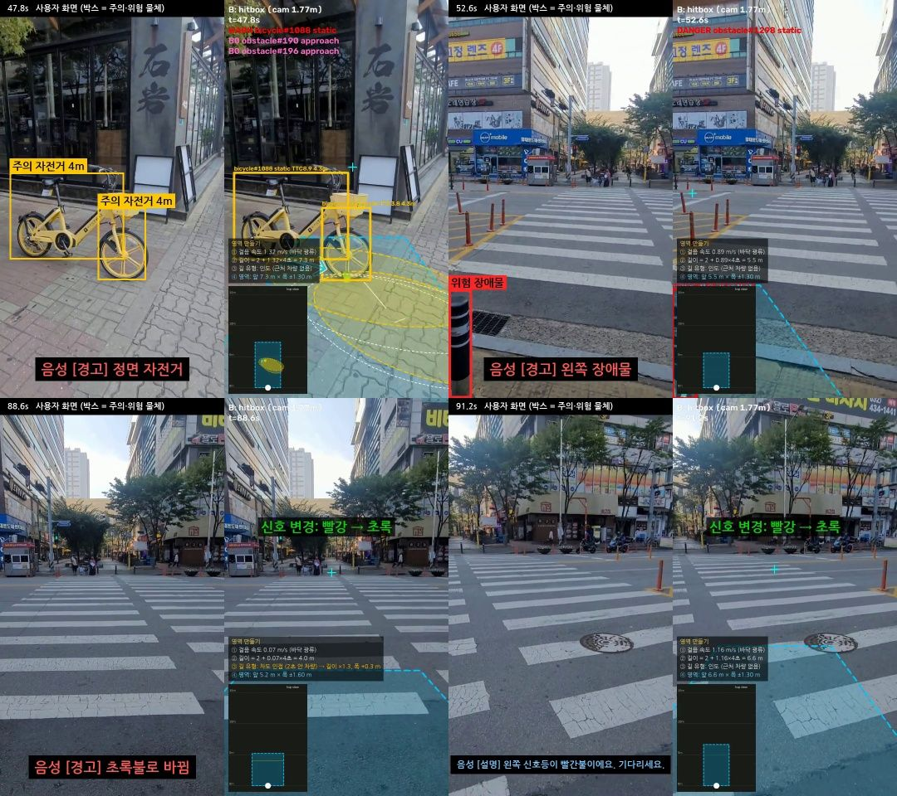
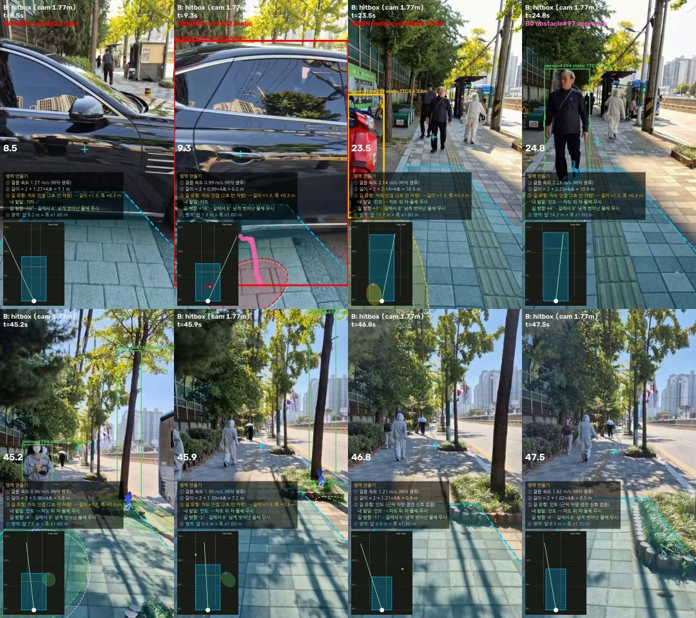

# 히트박스 트리거 (B) — 7주차 (2026-10-13 ~ )

몸에 단 폰 카메라 영상에서 **"언제, 무엇을, 어떻게" 말할지 정하는 트리거**를 새로 만들었다.
YOLO가 찾은 물체를 **바닥(미터) 좌표**로 옮겨서, 내가 걸어갈 영역(히트박스)과 겹치는지로 판단한다.
태규 규칙(B0, 화면 확대율 기반)을 기준선으로 같은 라벨에서 비교했다.

> 버전별로 무엇을 왜 바꿨는지: [`CHANGELOG.md`](CHANGELOG.md) · 영상 옆에 붙인 수정사항 원문: [`notes/`](notes/)
> 결과 원본(JSON): [`results/`](results/) · 코드: [`code/`](code/)



---

## 1. 한눈에 보기

| 질문 | 답 |
|---|---|
| 무엇을 만들었나 | 바닥 좌표 히트박스 트리거 + 음성 문장 규칙 + 비교 영상(왼쪽 사용자 화면, 오른쪽 판단 과정) |
| 기준선(B0) 대비 | 테스트 3편 **Recall 0.58 → 0.83** (위험만 알림, 여유 기준), 분당 오경보는 6.4 → 8.2 |
| 음성 | "**1시 방향 자동차가 지나가요. 멈추세요.**" 한 문장. 조각을 미리 합성해 이어 붙여 **트리거 후 0.02 s**에 소리 |
| 실행 환경 | 런유어AI RTX A5000. 인식 13 ms/프레임(GPU), 바닥 분할 54 ms(5프레임마다), 트리거 2.5 ms |
| 남은 문제 | 작은·기울어진 신호등 검출, 학습 영상 Recall(0.44), 오경보(분당 3~8회) |

## 2. 파이프라인

```
영상 ─┬─ ① YOLO 10클래스 + ByteTrack (conf 0.5 → 태규 B0, conf 0.2 → 히트박스용)      pass1_detect.py · pass1_lowconf.py
      ├─ ② 신호등만 고해상도 검출 (1920, conf 0.1) + 상자 안 픽셀 색(HSV)으로 빨강/초록   pass1_lights.py · pass1_lightcolor.py
      ├─ ③ 바닥 분할 Mask2Former(Mapillary): 인도·차도·횡단보도·연석·고정장애물·벽     pass1_surface.py
      └─ ④ 히트박스 트리거 (바닥 좌표 · 칼만 · 길 방향 · 행동 선택 · 음성 묶기)         pass2_trigger.py
               → events_runtime.json ─→ ⑤ 팀 실행 시스템(SJ code/runtime, 재생 큐·TTS)   sj_runtime_patch/
               → 히트박스 영상 + ⑥ 최종 비교 영상(소리 포함)                            final_render.py
채점: eval_trigger.py (라벨 구간 vs 트리거) · eval_159.py (AI Hub 159 인식) · 시간: bench_parts.py
```

### 판단 규칙 요약 (v5_9)

| 항목 | 규칙 |
|---|---|
| 거리 | 발 위치 + 클래스 키로 바닥 좌표 (카메라 높이 1.77 m = 촬영자 190 cm 눈높이, 26 mm 화각) |
| 내 영역 | 길이 = 2 m + 걸음 속도 × 4 s (걸음은 바닥 광류), 폭 ±1.3 m. 차도 옆·횡단보도면 조정 |
| 길 방향 | 바닥 분할의 인도 가운데선 → 휘는 방향. 인도 좌우 끝선(연석·화단)은 소실점 방향 직선 |
| 정면 | 길 중심선 **±0.25 m 막대**(사람 폭)에 물체 가장자리가 걸리면 "정면", 아니면 11·1시 … |
| 주의 | 물체 히트박스가 내 영역에 걸침 → 위치만 알림 ("1시 방향 장애물이 있어요.") |
| 위험 | 내 몸 폭 안 3 s 안 도달 · 2.5 m 안 · 움직이는 물체가 2 s 안에 내 몸 폭으로 들어옴(예측) |
| 행동 | 지나가거나 다가오는 차·사람, 계단, 2.5 m 안 = **멈추세요** / 그 외 = 덜 막힌 쪽 **피하세요** |
| 무시 | 길 방향·걷는 방향 둘 다에서 8° 넘게 벗어난 정지 물체, 인도 끝선 너머·차도 위 차, 멀어지는 물체, 빨간불 대기 중 지나가는 차 |
| 움직임 | 최근 1 s 거리 기울기 + 내 걸음 = 물체 자체 속도. 화면 끝에서 잘린 채 들어오는 물체는 안쪽 끝 속도로 "지나감" |
| 사람 | 평소엔 경고 안 함. 길 막음(앞 4 m에서 느려짐·멈춤) · 다가옴 · 가로질러 들어옴 · 충돌 코스만 |
| 반복 | 같은 트랙 ID는 한 번(정지→움직임, 바짝 접근은 예외). 박스 80 % 겹치면 같은 물체. 줄지은 기둥은 "이어져 있어요" 한 번 |
| 신호 | 길 방향 ±15° 정면 보행 신호만, 후보 색이 엇갈리면 판단 안 함(사거리). 0.5 s 확정 + 1.5 s 안 변경만 알림 |
| 횡단보도 | "횡단보도 앞 신호 대기 중이에요" · "횡단보도를 건너고 있어요" · 횡단보도 없는 곳 "차도를 건너고 있어요" · 대기 중 주변 사람이 걷기 시작하면 "주변 사람들이 건너기 시작했어요" |



## 3. 채점 (팀 기준 + 보완)

라벨: 팀이 직접 단 구간 (`code/labels.json`, 사람이 대강 단 구간이라 경계 오차 있음).
TP = 라벨 구간 안 맞는 사건의 트리거, FN = 없음, FP = 어느 구간에도 안 맞는 트리거.
보완: 같은 구간 여러 트리거는 TP 1개, 같은 물체 연속 FP는 1개. **여유 기준**은 구간 2 s 전 ~ 0.5 s 후 인정(미리 경고하는 방식 + 라벨 경계 오차).
Precision ↑ · Recall ↑ · F1 ↑ 는 높을수록, 분당 오경보 ↓ 는 낮을수록 좋다.

| 데이터 | 방식 | 기준 | TP / FP / FN | Precision ↑ | Recall ↑ | F1 ↑ | 분당 오경보 ↓ |
|---|---|---|---|---|---|---|---|
| 테스트 3편 (라벨 12) | 태규 B0 | 여유 | 7 / 42 / 5 | 0.14 | 0.58 | 0.23 | 6.4 |
| | B 주의+위험 | 여유 | 11 / 96 / 1 | 0.10 | **0.92** | 0.19 | 14.6 |
| | **B 위험만** | 여유 | 10 / 54 / 2 | **0.16** | **0.83** | **0.26** | 8.2 |
| | 태규 B0 | 엄격 | 3 / 47 / 9 | 0.06 | 0.25 | 0.10 | 7.1 |
| | B 위험만 | 엄격 | 8 / 58 / 4 | 0.12 | 0.67 | 0.21 | 8.8 |
| 학습 7편 (1·5·8·10·14·16·18, 라벨 16) | 태규 B0 | 여유 | 0 / 37 / 16 | 0 | 0 | 0 | 3.9 |
| | B 주의+위험 | 여유 | 7 / 65 / 9 | 0.10 | 0.44 | 0.16 | 6.8 |
| | **B 위험만** | 여유 | 7 / 29 / 9 | **0.19** | **0.44** | **0.27** | **3.0** |

- 학습 20편 중 7편만 돌렸다(시간 부족). 나머지 13편은 다음에.
- **B0 학습 Recall 0**은 태규 노트북의 "Test Recall 46.67 %"와 크게 다르다. 검출 모델(여기선 최종 10클래스 conf 0.5)과 채점 방식이 다를 수 있어, 태규가 쓴 best.pt · 채점 코드로 같은 조건 비교가 필요하다.
- 학습에서 놓친 것: 신호 변경 4개(작은·기울어진 신호등을 YOLO가 못 찾음, 반대쪽 신호등 뒷면이 잡힘), 킥보드·오토바이 접근 5개.
- FP에는 라벨에 없지만 실제로 길을 막는 물체(볼라드·화단)도 섞여 있다.

## 4. 시간 측정 (A5000, 파트별 중간값)

| 파트 | GPU | CPU | 비고 |
|---|---|---|---|
| 프레임 읽기 | – | 3 ms | |
| YOLO 검출+추적 | **13 ms** | 40 ms (4·8·16 스레드 비슷) | |
| 배경 광류(트리거) | – | **43 ms** | 프레임당 가장 큰 비용 |
| 트리거 판단 | – | 2.5 ms | |
| 신호 분류 | 4.5 ms | 4.7 ms | CPU로 충분 |
| 바닥 분할 | 54 ms (5프레임마다) | – | Mask2Former Swin-L |
| VLM Qwen2.5-VL-7B (8장) | 0.84 s → YOLO도 GPU면 0.93 s | – | YOLO를 CPU로 빼면 0.85 s |
| TTS Supertonic (서버 CPU) | – | 1.26 s → 경합 1.35 s | Heami(노트북) 0.01–0.03 s |

실제 속도 end-to-end (test 1·2·3, 중간값): **GPU만** 경고 지연 0.02 s · 프레임 지연 0.02 s · 인식 18–22 ms / **나눠 쓰기(YOLO CPU 8스레드, VLM GPU)** 경고 0.05 s · 프레임 0.05 s · 인식 43–50 ms.
→ 나눠 써도 지연은 거의 안 늘지만 CPU만이면 약 12 fps가 상한이다. 원본: `results/bench_parts.json`, `results/e2e_*.json`.

## 5. 해 본 것 · 버린 것

| 시도 | 결과 |
|---|---|
| A안: 칼만 + 화면 TTC + 경로 띠 + FOE | 히트박스(B)보다 못해서 B로 진행 |
| CoTracker3 (점 추적) | 노트북 CPU 0.8–9 s/프레임, RAM 부족으로 중단. 1초 고정 화살표로 대체 |
| SegFormer Cityscapes 바닥 분할 | 한국 벽돌 인도를 차도로 칠함 → **Mapillary Mask2Former**로 교체 ([그림](img/seg_cityscapes_fail_test3.jpg) vs [교체 후](img/seg_mapillary_test3.jpg)) |
| 깊이 추정 Depth Anything V2 | YOLO가 못 잡는 박스 더미를 6–7 m 앞 장애물로 찾음 ([그림](img/depth_boxpile_test3.jpg)), 80 ms. 아직 트리거에 미연결 |
| 신호 분류기만 사용 | 기울어진 신호등을 '꺼짐'으로 봄 → 상자 안 HSV 색으로 직접 판단 |
| AI Hub 159 (1인칭 보행영상) 인식 채점 | 2,563장, conf 0.2 기준 자동차 R 0.73 · 사람 0.53 · 오토바이 0.48 · **장애물 0.10** (나무·표지판·가로등을 장애물로 안 배움). `results/eval_159.json` |
| 30° 시계 방향 vs 45° 8방향 | 폰 화각이 좌우 ±21°라 8방향이면 전부 '앞' → 시계 방향 + 정면 막대 |

## 6. 실행 방법 (서버)

```bash
# 영상 하나 (OUT=../out/<이름>)
python pass1_detect.py final_10class_best.pt VIDEO OUT          # YOLO conf 0.5 + 태규 B0 + 광류
python pass1_lowconf.py final_10class_best.pt VIDEO OUT         # YOLO conf 0.2 (히트박스용)
LIGHT_IMGSZ=1920 LIGHT_CONF=0.1 LIGHT_OUT=lights2.json \
  python pass1_lights.py final_10class_best.pt signal_state_cls_best.pt VIDEO OUT
LIGHT_IN=lights2.json python pass1_lightcolor.py VIDEO OUT      # → lights2_hsv.json
python pass1_surface.py VIDEO OUT                               # → surface2.npz
LIGHT_FILE=lights2_hsv.json CAM_H=1.77 PANELS=B VERSION=v5_9 python pass2_trigger.py OUT   # 히트박스 영상 + events_runtime.json
# 음성: SJ code/runtime (sj_runtime_patch 적용) — replay 트리거, VLM 끔
python run_demo.py --clip test_3 --perception yolo --tracks F10 --device 0 --trigger replay:<events 폴더> \
  --vlm none --tts server --tts-url http://localhost:7788/v1 --tts-model supertonic-3 --tts-voice M1 --run v59
DUMP=1 CAM_H=1.77 PANELS=B python pass2_trigger.py OUT && python final_render.py OUT <run 폴더> OUT/hitbox_B.mp4 최종.mp4
# 채점
python eval_trigger.py labels.json test <OUT 상위 폴더>
```

결과 영상(파일당 50–110 MB, GitHub 용량 때문에 미포함)은 박주영 노트북 `Documents/trigger_proto/out/test_N/`에 있다:
`test_N_최종_음성_비교_v5_9.mp4`(왼쪽 사용자 화면 + 음성 자막, 오른쪽 판단 과정), `test_N_히트박스_v5_9_수정본.mp4`.

## 7. 다음 할 일

1. 작은·기울어진 신호등: 신호등 검출 보강(학습 데이터) 또는 색 블롭 후보 + 추적
2. 깊이 기반 장애물(박스 더미 등)을 트리거에 연결
3. 학습 나머지 13편 채점, 태규와 같은 조건(best.pt · 채점 코드)으로 B0 비교
4. 영상 시작 직후 "횡단보도를 건너고 있어요" 오안내(바닥 분할 초기값) 정리
5. 폰 자이로·가속도 기록이 있으면 걸음 속도·흔들림을 센서로 대체
